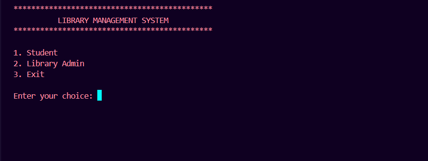
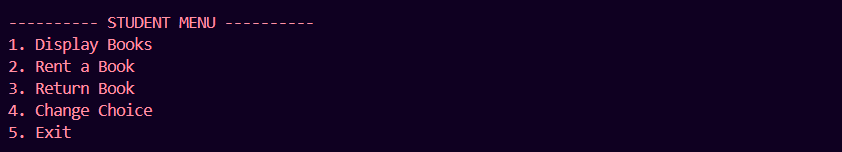
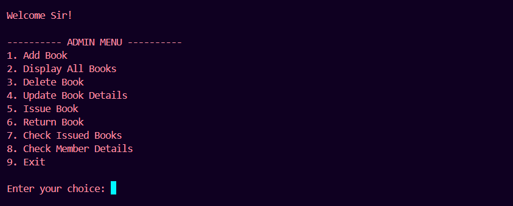
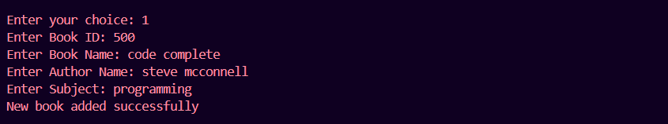
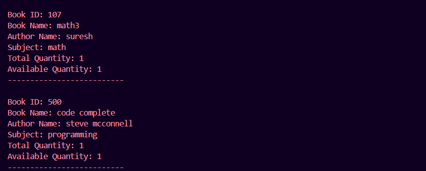
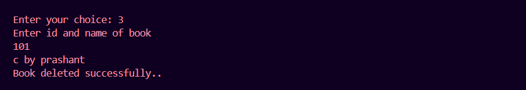
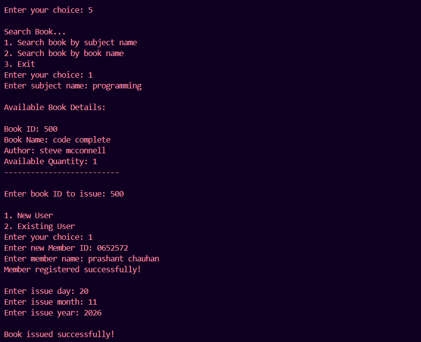
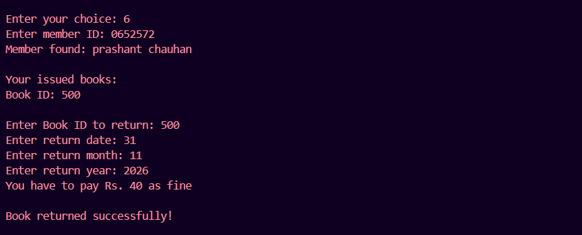

# Library Management System

A console-based Library Management System developed in C to manage books, library members, book issuing, returns, and fine calculation. This project uses dynamic memory allocation and binary file handling to store and manage library records.

## Features

### Book Management
- Add new books to the library
- Increase quantity of existing books
- Display all books
- Delete books
- Update book details
- Search books by name or subject

### Member Management
- Register new members
- Search members using Member ID
- Maintain member records

### Book Issue & Return
- Issue books to registered members
- Track issued books
- Return books
- Automatically update book availability

### Fine Calculation
- One-week borrowing period
- ₹10 fine per day after the permitted borrowing period
- Calculate fines based on overdue days

### Data Persistence
- Store book, member, and issue records in binary files
- Load records when the program starts
- Save updated data after operations
- Maintain data across program restarts

## Screenshots

### Main Menu


### Student Menu


### Admin Menu


### Book Management

#### Add Book


#### Display Books


#### Delete Book


### Book Issue & Return

#### Issue Book


#### Return Book


## Technologies Used

- C Programming
- Structures
- Pointers
- Dynamic Memory Allocation (`malloc`, `realloc`, `free`)
- Binary File Handling (`fread`, `fwrite`)
- Git & GitHub

## Project Structure

```text
Library-Management-System/
│
├── main.c
├── library.c
├── library.h
├── .gitignore
│
└── screenshots/
    ├── mainmenu.png
    ├── studentmenu.png
    ├── adminmenu.png
    ├── addbook.png
    ├── displaybook.png
    ├── deletebook.png
    ├── issuebook.png
    └── returnbook.png
```

## How to Run

### Prerequisites
- GCC compiler
- Windows or Linux

### Compile

```bash
gcc main.c library.c -o library
```

### Run on Windows

```powershell
.\library.exe
```

### Run on Linux

```bash
./library
```

## Data Files

| File | Description |
|---|---|
| `book.dat` | Stores book records and quantity |
| `member.dat` | Stores library member records |
| `issue.dat` | Stores book issue and return records |

These files are created and managed by the application at runtime.

## Learning Objectives

This project helped me practice:

- Dynamic memory allocation and memory management
- Structures and structure pointers
- CRUD operations
- Binary file handling
- Persistent data storage
- Modular programming
- Managing relationships between books, members, and issue records

## Author

**Prashant Chauhan**
